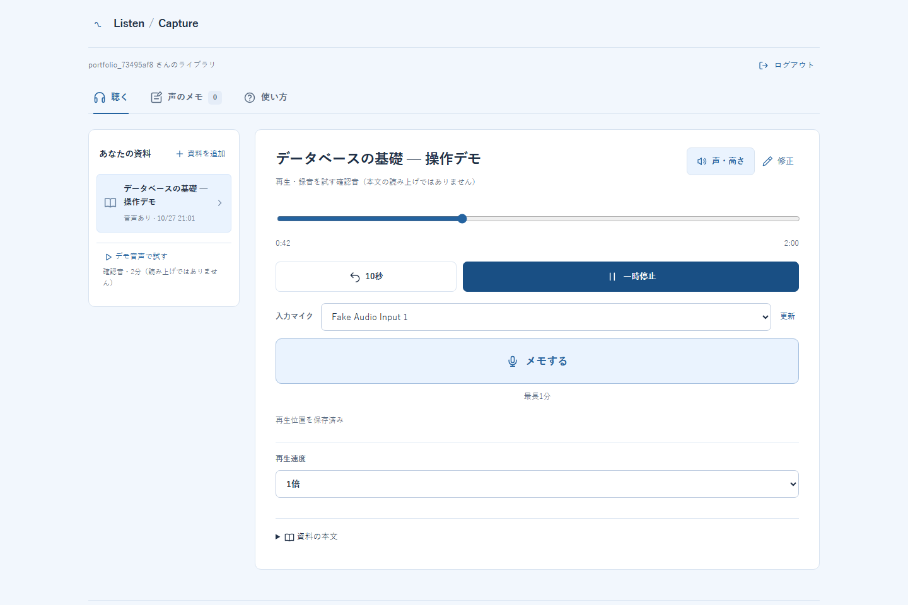
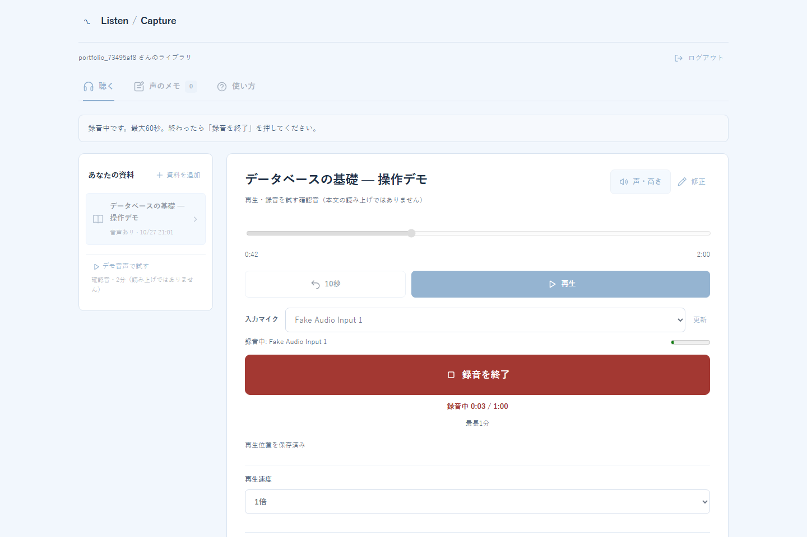
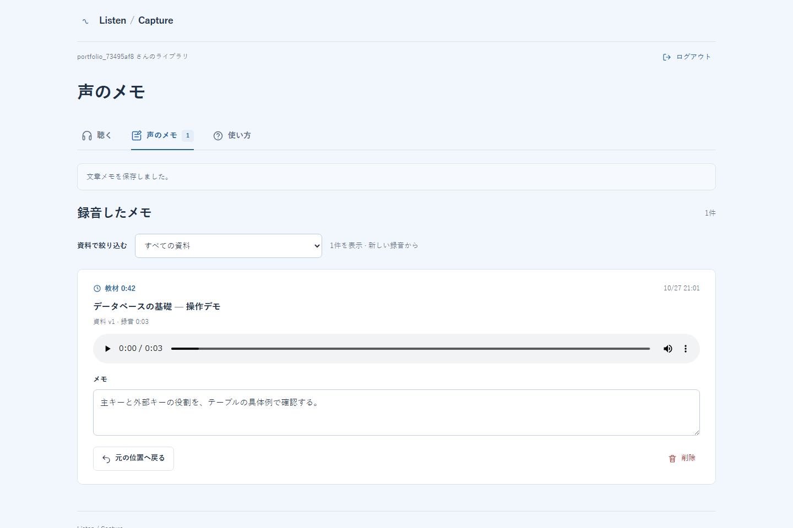
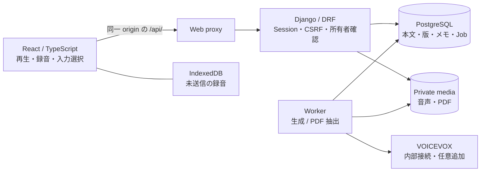

# Listen / Capture

**教材を聴きながら浮かんだ考えを、声と再生位置で残す。**

Listen / Capture は、資料の読み上げと音声メモをつなぐ Desktop Web アプリです。「メモする」を押すと教材が止まり、録音を保存した後はその位置から再開できます。後日メモを聴き直すときも、録音した当時の本文と音声へ戻れます。

*A desktop web app for listening to study materials, capturing voice notes, and returning to their original context.*

> **Desktop v1.0.0** — 個人利用の完成版から公開向けに整理したソースです。公開デモサーバーはありません。[ローカル起動手順](docs/setup.md)で試せます。

## 聴く → 録る → 元の位置へ戻る

講義資料を読み上げで聴いているとき、疑問が浮かぶたびに別のメモアプリへ移ると、聴いていた場所や考えを見失います。この作品では、**「教材を止める・録る・元の位置へ戻る」を一つの流れにしました。**

**1. 教材を聴く。** テキストや PDF の本文から音声を生成し、声・高さ・再生速度を選べます。



**2. 気づいたら「メモする」。** 教材が止まり、選んだマイクで最大 60 秒録音できます。保存状態を確認し、自分の声を聴いてから教材を再開します。



**3. あとから振り返る。** 録音を聴き直し、文章を追記し、元の本文・音声・位置へ戻れます。本文や声を変えた後も、過去の録音の参照を保ちます。

<details>
<summary>振り返りの画面を見る</summary>



保存した声を再生し、「元の位置へ戻る」で録音した当時の教材へ戻ります。

</details>

*3 枚とも、公開用の架空教材と合成マイクを使って取得した実画面です。個人の教材・録音は含まず、ローカル本人実マイク確認や AWS 受け入れ検証の画像ではありません。*

PDF は文字情報の抽出に対応し、読み順を確認・修正してから確定します。OCR は行いません。標準のデモ音源は操作確認用の合成音で、任意の本文を読み上げたものではありません。本文の音声化には、任意追加の VOICEVOX を設定します。

## 大切にした設計

### 1. 「応答が来ない」と「保存されていない」を分ける

録音を保存していても、通信が切れて応答だけ届かないことがあります。録音を利用者別の IndexedDB に一時退避し、同じ UUID で再送します。サーバーでは利用者と UUID の組を一意にし、内容の照合と行ロックにより重複保存を抑えます。画面の「保存済み」は、サーバーの応答を確認してから表示します。

### 2. 教材を編集しても、昔のメモの意味を変えない

本文と音声を上書きせず、それぞれの版を保存します。メモは **音声版と再生位置**を参照し、そこから元の本文版へたどります。声を変えて再生成しても、古いメモが別の音声の同じ秒数へ移ることはありません。

### 3. 音声生成を、待てる・止められる処理にする

生成依頼を PostgreSQL に保存し、Worker が区間ごとに処理します。成功した区間は再利用し、失敗や中断後は明示的に再開します。中断は現在の区間を保存してから確定するため、即時停止ではありません。複雑な分散基盤を加えず、小さな構成で処理状態を追えることを優先しました。

各判断の限界とコードの入口は [設計ノート](docs/design.md) にまとめています。

## 全体構成



録音するのはブラウザ、保存を確定するのは API、長い生成を進めるのは Worker です。音声ファイルを DB に直接保存せず、DB の参照と非公開ファイルを対応させます。

| 役割 | 技術 |
| --- | --- |
| UI・音声操作 | React、TypeScript、Vite、MediaRecorder、IndexedDB |
| API・認証・非同期処理 | Python、Django、Django REST Framework、Django management commands |
| データ・音声 | PostgreSQL 17、VOICEVOX、FFmpeg / FFprobe、private storage |
| 実行・検証 | Docker Compose、Vitest、Playwright、Django tests、GitHub Actions |
| 非公開クラウド配置 | AWS EC2、S3、ECR、SSM。公開候補で VOICEVOX を確認。Polly は開発原本の過去実績 |

## 起動と検証

まず [セットアップ](docs/setup.md) の Docker 手順で、外部の音声生成サービスを使わずにデモの再生・録音・保存を試せます。日本語の読み上げを試す場合だけ、VOICEVOX を追加します。AWS アカウントはローカル起動に不要です。

| 確認した環境・対象 | 実際に確認できたこと |
| --- | --- |
| ローカル Docker（2026-10-27） | 公開版と同一のアプリ内容で、新しい DB・保存先を使ってクリーン起動 |
| 実 VOICEVOX 0.25.2（ローカル・AWS） | 日本語の生成、区間完了を待つ中断、保存済み区間からの明示再開 |
| 本人の短いローカル操作（2026-10-27） | 日本語音声の聴取、実マイク録音・試聴、再読み込み後の録音と元位置への復帰 |
| 非公開 AWS（2026-10-28） | 公開版と同一のアプリ内容の image で HTTPS・実 VOICEVOX・合成マイク録音・振り返り、CSRF・所有者分離。実マイク・本人聴感の確認はローカルのみ |
| Backup / Restore（同 AWS 検証） | 更新前後の DB / media を暗号化退避し、別のローカル PostgreSQL 17・保存先へ独立復元。終了後は AWS の停止を確認 |
| GitHub Actions | CI 定義を同梱。新規 Private への初回 push では Actions を無効化し、新規 run は未実施。[実行状況](https://github.com/yutoo77/listen-capture-app/actions)を参照。過去の CI 成功を今回へ流用しない |

失敗・修正・skip と測定条件、公開するアプリ内容と過去の配置・検証結果の対応は [検証記録](docs/verification.md) にまとめています。新しい Git 履歴を作ったこと自体を、実動作試験の再実施とは扱いません。

- [検証結果と再現方法](docs/verification.md)：候補での確認、開発原本の過去実績、未検証範囲。
- [Security](docs/security.md)：所有者認可、CSRF、非公開ファイル、公開運用に向けた限界。
- [設計ノート](docs/design.md)：保存・版・Worker・復元の判断とコードへのリンク。

```text
frontend/       画面、音声操作、端末内の再送待ち
backend/        API、モデル、Migration、Worker、Backend tests
infra/          Dockerfile、Web proxy の設定
scripts/        起動補助、検証、Backup / Restore
tests/e2e/      ブラウザの操作テスト
docs/           セットアップ、設計、検証、Security
```

## 現在の制約と今後

Desktop の個人利用を対象としています。スマートフォンの正式対応、AirPods のボタンによる録音操作、一般利用者向けの公開サービス、24 時間運用は対象外です。30〜60 分の本人連続利用と大規模負荷試験は未実施です。次の拡張では、実機検証と公開運用の認証・制限・監視を整える必要があります。

## 開発について

個人の学習課題を出発点に、課題設定、要件整理、機能の優先順位、完成範囲と受け入れ条件を検討・判断し、実機での動作確認と機能の受け入れを行いました。設計案の比較、実装、テスト、文書化には Codex を活用しています。主要な設計判断と検証結果は、[設計ノート](docs/design.md)と[検証記録](docs/verification.md)にまとめています。

## 利用条件

本プロジェクトの自作コードは [MIT License](LICENSE) で公開します。依存ライブラリ・音声エンジン・音声ライブラリには、それぞれの利用条件が適用されます。[第三者の権利と同梱物](THIRD_PARTY_NOTICES.md)を確認してください。
