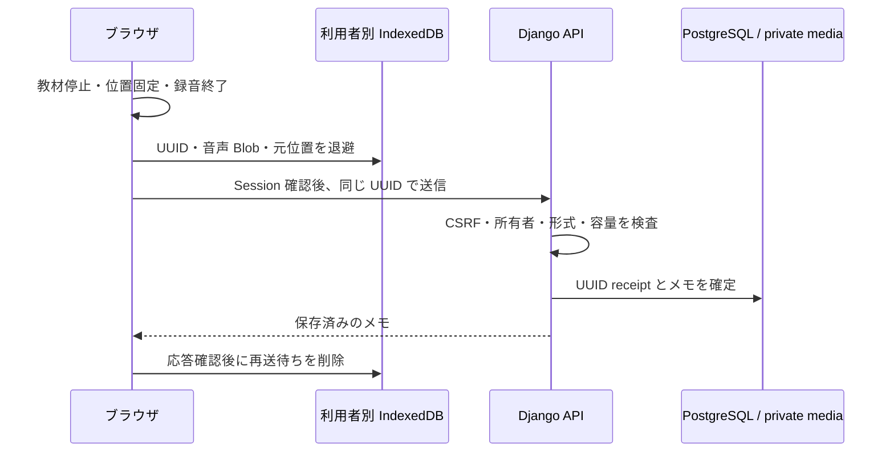
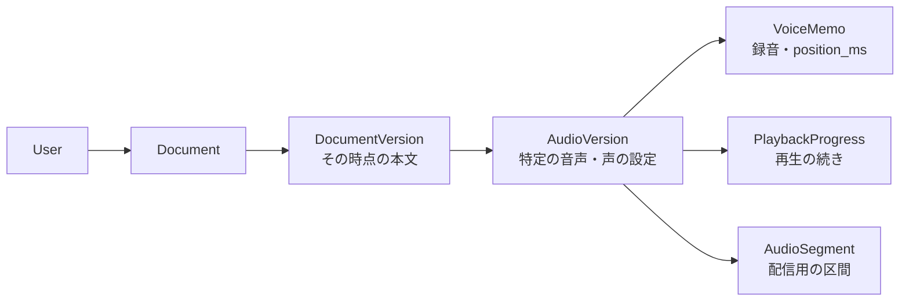

# 設計ノート

目的は、学習中に生まれた自分の声を残し、後から元の教材へ戻れることです。音声操作はブラウザ、認可と保存確定は Django、長い処理は Worker に分けています。API と Worker は同じ Django モデル・サービスを利用する構成です。

## 1. 保存の応答を失っても、同じ録音を送る

応答が届かない場合、サーバー側だけ成功している可能性があります。新しい UUID を作ってやり直さず、同じ録音・UUID で確認します。API は利用者と UUID の組を一意にし、位置や音声 bytes を含む digest を比較します。同じ内容なら元のメモを返し、異なる内容なら `409` にします。削除済みメモの receipt も残し、遅い再送で復活させません。

再送前には Session と CSRF を取り直し、録音した利用者と現在の利用者を照合します。ただし、この確認と POST の間の Cookie 変更は原子的に防げません。Backend の親資料の所有者確認が最後の境界です。

**トレードオフ：** IndexedDB は復旧の補助で、永続保存の保証ではありません。退避できなければタブ内保持とダウンロードを案内します。receipt は安全な遅延再送のため保持しますが、その件数上限・保持期間は今後の課題です。

実装：[capture.ts](../frontend/src/capture.ts)、[outbox.ts](../frontend/src/outbox.ts)、[App.tsx の sendPending](../frontend/src/App.tsx)、[create_memo](../backend/capture/services.py)。検証：[並行保存](../backend/capture/tests/test_services.py)、[outbox](../frontend/src/outbox.test.ts)、[保存・応答喪失の E2E](../tests/e2e/product-memo-response.spec.ts)。

## 2. 本文と声を変えても、昔の録音を守る

本文編集や話者・高さ変更は、新しい版を追加します。メモは最新の資料ではなく、録音時の音声版を参照します。音声が複数ファイルに分かれても、位置は全体のミリ秒として保存します。全体時計は元 PCM のサンプル数を基準にし、MP3 と WAV の混在を扱います。

**トレードオフ：** 旧版を残すため容量と参照管理が必要です。音声の秒数から本文の単語位置が正確に求まるわけではなく、画面の本文対応は区間単位です。音声の長さだけから圧縮後の容量も保証しません。

実装：[models.py](../backend/capture/models.py)、[profile の不変性を保つ Migration](../backend/capture/migrations/0010_voicevox_profiles.py)、[LogicalPlayer](../frontend/src/player.ts)。検証：[版と元位置](../backend/capture/tests/test_context.py)、[Playlist](../backend/capture/tests/test_playlist.py)、[Migration](../backend/capture/tests/test_voicevox_migrations.py)。

## 3. Worker は短くロックし、長い生成はロックの外へ

API は依頼・本文版・声の profile・UUID を DB に記録して返します。Worker は行ロックで Job を取得し、lease と token を記録してから外部処理へ進みます。遅れて完了した旧 Worker の結果は、token と lease で拒否します。

生成は区間ごとに PCM を保存します。明示的な再開では成功区間を再利用し、必要な区間だけ生成します。実行結果が不明な区間は自動的に再生成せず、利用者へ確認します。VOICEVOX の停止を有料 Polly への自動切り替えで回避しません。

中断要求は DB に保存します。待機中なら開始を止め、実行中なら処理中の区間を保存してから止めます。そのため「中断しています」の間は待ち時間が発生します。エンジンの計算を即座に強制終了する機能ではありません。

**トレードオフ：** PostgreSQL の queue は追加サービスを減らせますが、ポーリングと lease の設計・運用が必要です。外部 TTS の実行と DB 確定を一つの transaction にできないため、外部課金の exactly-once は保証しません。

実装：[narration.py](../backend/capture/narration.py)、[voicevox_provider.py](../backend/capture/voicevox_provider.py)、[容量予約](../backend/capture/tts_capacity.py)。検証：[生成](../backend/capture/tests/test_narration.py)、[中断競合](../backend/capture/tests/test_narration_cancel.py)、[VOICEVOX](../backend/capture/tests/test_voicevox.py)。

## 4. DB とファイルを、一つの復元対象として扱う

DB は本文・所有者・版・位置・ファイル参照を持ち、実際の音声と PDF は非公開ファイルとして保存します。ファイルだけ、または DB だけを戻しても整合しません。

Backup は writer を止めた DB と media の対を作り、参照対象の網羅と SHA-256 を確認します。Restore は新規の制限権限 PostgreSQL と別 media 領域へ行います。ファイルが読めるだけでなく、所有者・元位置・profile・UUID receipt を保てるかが確認対象です。

**トレードオフ：** 書き込み停止の時間が必要です。任意時点へ戻る仕組みや、AWS ホストを丸ごと再構築する保証とは異なります。DB transaction とファイル保存は単一の原子的操作ではなく、失敗時の削除補償と孤立ファイル点検も必要です。

実装：[storage.py](../backend/capture/storage.py)、[backup_private.py](../scripts/backup_private.py)、[Backup 整合性テスト](../scripts/test_backup_integrity.py)。確認範囲は [検証記録](verification.md) を参照してください。

## 構成を増やさなかった理由

- 同一 origin と Django Session を使い、ブラウザへ長寿命 API キーを置かない。
- 小規模な個人利用に合わせ、API・Worker・DB を分けつつサービスごとの独立開発にはしない。
- AI 分類・採点・会話は加えず、音声メモの保存と参照に集中する。
- ローカルと AWS は配置先が異なるだけで、同じアプリの責務を保つ。データは自動同期しない。
